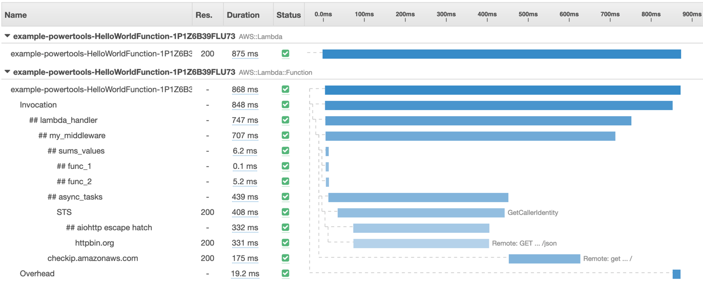

The Tracing OpenTelemetry utility provides an opinionated integration with [OpenTelemetry](https://opentelemetry.io/) for AWS Lambda. It reduces the overhead of performing distributed tracing tasks by automatically creating spans, extracting trace context from various AWS Lambda event sources, capturing cold starts, responses, and errors, and exporting traces to OpenTelemetry Protocol (OTLP) collectors or AWS Distro for OpenTelemetry (ADOT).



 **Key Features**

 * Automatic span lifecycle management for Lambda handlers and arbitrary methods using the `@Tracing` annotation or programmatic API.
 * Capture cold start as attribute (`faas.coldstart`), Lambda invocation ID (`faas.invocation_id`), responses, and full exceptions.
 * Built-in trace context extraction and span enrichment for major AWS Lambda event sources (API Gateway, SQS, SNS, Kinesis, DynamoDB Streams, S3).
 * Flexible context propagation modes (`PARENT` and `LINK`) supporting W3C Trace Context and AWS X-Ray formats.
 * Automatic configuration for OTLP exporters (gRPC and HTTP/Protobuf) and seamless compatibility with Global OpenTelemetry (e.g. ADOT Java agent / Lambda layer).
 * Programmatic tracing API (`TracingOpenTelemetry`) for custom spans, scopes, and manual context injection/extraction.
 * Automatic User-Agent tagging for AWS SDK for Java 2.x clients.
 * GraalVM support.

## Install

=== "Maven"

    ```xml hl_lines="3-7 25-28"
    <dependencies>
        ...
        <dependency>
            <groupId>software.amazon.lambda</groupId>
            <artifactId>powertools-tracing-opentelemetry</artifactId>
            <version>{{ powertools.version }}</version>
        </dependency>
        ...
    </dependencies>
    ...
    <!-- configure the aspectj-maven-plugin to compile-time weave (CTW) the aws-lambda-powertools-java aspects into your project -->
    <!-- Note: This AspectJ configuration is not needed when using the programmatic approach -->
    <build>
        <plugins>
            ...
            <plugin>
                 <groupId>dev.aspectj</groupId>
                 <artifactId>aspectj-maven-plugin</artifactId>
                 <version>1.14</version>
                 <configuration>
                     <source>17</source> <!-- or higher -->
                     <target>17</target> <!-- or higher -->
                     <complianceLevel>17</complianceLevel> <!-- or higher -->
                     <aspectLibraries>
                         <aspectLibrary>
                             <groupId>software.amazon.lambda</groupId>
                             <artifactId>powertools-tracing-opentelemetry</artifactId>
                         </aspectLibrary>
                     </aspectLibraries>
                 </configuration>
                <dependencies>
                    <dependency>
                        <groupId>org.aspectj</groupId>
                        <artifactId>aspectjtools</artifactId>
                        <!-- AspectJ compiler version, in sync with runtime -->
                        <version>1.9.22</version>
                    </dependency>
                </dependencies>
                 <executions>
                     <execution>
                         <goals>
                             <goal>compile</goal>
                         </goals>
                     </execution>
                 </executions>
            </plugin>
            ...
        </plugins>
    </build>
    ```

=== "Gradle"

    ```groovy hl_lines="3 11 12"
        plugins {
            id 'java'
            id 'io.freefair.aspectj.post-compile-weaving' version '8.1.0' // Not needed when using the programmatic approach
        }
        
        repositories {
            mavenCentral()
        }
        
        dependencies {
            aspect 'software.amazon.lambda:powertools-tracing-opentelemetry:{{ powertools.version }}' // Not needed when using the programmatic approach
            implementation 'software.amazon.lambda:powertools-tracing-opentelemetry:{{ powertools.version }}' // Use this instead of 'aspect' when using the programmatic approach
        }
        
        sourceCompatibility = 17 // or higher
        targetCompatibility = 17 // or higher
    ```

## Initialization

Before using this utility, ensure your environment is configured to export OpenTelemetry traces (such as using an OpenTelemetry Collector, AWS Distro for OpenTelemetry (ADOT), or a generic OTLP backend).

> Example using AWS Serverless Application Model (SAM)

=== "template.yaml"

    ```yaml hl_lines="8 10-14"
    Resources:
        HelloWorldFunction:
            Type: AWS::Serverless::Function
            Properties:
            ...
            Runtime: java17
    
            Tracing: Active
            Environment:
                Variables:
                    POWERTOOLS_SERVICE_NAME: example
                    POWERTOOLS_TRACE_CONTEXT_PROPAGATION_MODE: PARENT
                    OTEL_EXPORTER_OTLP_TRACES_PROTOCOL: grpc
                    OTEL_EXPORTER_OTLP_TRACES_ENDPOINT: http://localhost:4317
    ```

The following environment variables can be configured:

| Environment Variable | Description | Default |
| --- | --- | --- |
| **`POWERTOOLS_SERVICE_NAME`** | Service name associated with the Lambda function resource | `""` |
| **`POWERTOOLS_TRACE_CONTEXT_PROPAGATION_MODE`** | Propagation strategy: `PARENT` or `LINK` | `PARENT` |
| **`POWERTOOLS_TRACER_CAPTURE_RESPONSE`** | Capture method response in span attribute | `false` |
| **`POWERTOOLS_TRACER_CAPTURE_ERROR`** | Capture thrown exception in span | `false` |
| **`OTEL_EXPORTER_OTLP_TRACES_PROTOCOL`** | Exporter protocol: `grpc` or `http/protobuf` | `grpc` |
| **`OTEL_EXPORTER_OTLP_TRACES_ENDPOINT`** | Target OTLP endpoint (e.g., `http://localhost:4317`) | Collector default |
| **`OTEL_EXPORTER_OTLP_TRACES_HEADERS`** | Comma-separated list of headers (`key=value,key2=value2`) | `""` |

### Lambda handler

You can enable tracing using either the `@Tracing` annotation or the programmatic API.

**With the `@Tracing` annotation**, add it to your `handleRequest` method or any internal method to capture it as a separate span automatically. You can optionally customize the span name and namespace.

**With the programmatic API**, use `TracingOpenTelemetry.create()` to manually manage spans without AspectJ configuration.

=== "@Tracing annotation"

    ```java hl_lines="3 10 15"
    public class App implements RequestHandler<APIGatewayProxyRequestEvent, APIGatewayProxyResponseEvent> {
    
        @Tracing
        public APIGatewayProxyResponseEvent handleRequest(APIGatewayProxyRequestEvent input, Context context) {
            businessLogic1();
    
            businessLogic2();
        }
    
        @Tracing
        public void businessLogic1(){
    
        }
    
        @Tracing
        public void businessLogic2(){
    
        }
    }
    ```

=== "Programmatic API"

    ```java hl_lines="1 6 7 8 10 11 12"
    import software.amazon.lambda.powertools.tracing.opentelemetry.TracingOpenTelemetry;

    public class App implements RequestHandler<APIGatewayProxyRequestEvent, APIGatewayProxyResponseEvent> {
    
        public APIGatewayProxyResponseEvent handleRequest(APIGatewayProxyRequestEvent input, Context context) {
            TracingOpenTelemetry.create().withSpan("businessLogic1", span -> {
                // Business logic 1
                return null;
            });
    
            TracingOpenTelemetry.create().withSpan("businessLogic2", span -> {
                // Business logic 2
                return null;
            });
        }
    }
    ```

=== "Custom Span names"

    ```java hl_lines="3"
    public class App implements RequestHandler<APIGatewayProxyRequestEvent, APIGatewayProxyResponseEvent> {
    
        @Tracing(spanName="yourCustomSpanName")
        public APIGatewayProxyResponseEvent handleRequest(APIGatewayProxyRequestEvent input, Context context) {
        ...
        }
    ```

When using the `@Tracing` annotation on a Lambda handler, the utility performs these additional tasks:

  * Creates a `faas.coldstart` attribute to easily identify cold starts.
  * Adds the `faas.invocation_id` attribute containing the AWS Request ID.
  * Automatically extracts incoming trace context from supported Lambda event sources (API Gateway, SQS, SNS, Kinesis, DynamoDB, S3) and enriches the span with event details.
  * Captures responses and full exceptions based on the configured capture mode.
  * Automatically flushes telemetry data when handler execution finishes.

By default, the `@Tracing` annotation uses `captureMode = CaptureMode.ENVIRONMENT_VAR`, which means it will record method responses and exceptions only if you set the environment variables `POWERTOOLS_TRACER_CAPTURE_RESPONSE` and `POWERTOOLS_TRACER_CAPTURE_ERROR` to `true`. You can override this behavior by specifying a different `captureMode`:

* `CaptureMode.ENVIRONMENT_VAR` (default): Uses environment variables.
* `CaptureMode.RESPONSE`: Always captures the response.
* `CaptureMode.ERROR`: Always captures exceptions.
* `CaptureMode.RESPONSE_AND_ERROR`: Captures both response and exceptions.
* `CaptureMode.DISABLED`: Disables response and exception capture.

!!! note
    When using the programmatic API with `TracingOpenTelemetry`, response capture is manual, while `withSpan` automatically records thrown exceptions on the span before propagating them.

!!! warning "Returning sensitive information from your Lambda handler or functions?"
    When using the `@Tracing` annotation, you can disable response and exception capture with **`captureMode = CaptureMode.DISABLED`**
    or globally by setting the environment variables **`POWERTOOLS_TRACER_CAPTURE_RESPONSE`** and **`POWERTOOLS_TRACER_CAPTURE_ERROR`** to **`false`**.

=== "@Tracing annotation - Disable on method"

    ```java hl_lines="3"
    public class App implements RequestHandler<APIGatewayProxyRequestEvent, APIGatewayProxyResponseEvent> {
    
        @Tracing(captureMode = CaptureMode.DISABLED)
        public APIGatewayProxyResponseEvent handleRequest(APIGatewayProxyRequestEvent input, Context context) {
        ...
        }
    ```

=== "@Tracing annotation - Disable Globally"

    ```yaml hl_lines="11 12"
    Resources:
        HelloWorldFunction:
            Type: AWS::Serverless::Function
            Properties:
            ...
            Runtime: java17
    
            Tracing: Active
            Environment:
                Variables:
                    POWERTOOLS_TRACER_CAPTURE_RESPONSE: false
                    POWERTOOLS_TRACER_CAPTURE_ERROR: false
    ```

=== "Programmatic API"

    ```java hl_lines="6 7 8"
    import software.amazon.lambda.powertools.tracing.opentelemetry.TracingOpenTelemetry;

    public class App implements RequestHandler<APIGatewayProxyRequestEvent, APIGatewayProxyResponseEvent> {
    
        public APIGatewayProxyResponseEvent handleRequest(APIGatewayProxyRequestEvent input, Context context) {
            TracingOpenTelemetry.create().withSpan("businessLogic", span -> {
                // You have full control over what attributes are set on the span
                return null;
            });
        }
    ```

### Attributes & Events

In OpenTelemetry, **Attributes** are key-value pairs associated with spans used for querying and filtering traces. **Events** are timestamped annotations within a span representing specific moments during execution.

=== "Attributes"

    You can add attributes directly to the active span using OpenTelemetry API:
    ```java hl_lines="2 8"
    import io.opentelemetry.api.trace.Span;
    import software.amazon.lambda.powertools.tracing.opentelemetry.Tracing;

    public class App implements RequestHandler<APIGatewayProxyRequestEvent, APIGatewayProxyResponseEvent> {
    
        @Tracing
        public APIGatewayProxyResponseEvent handleRequest(APIGatewayProxyRequestEvent input, Context context) {
            Span.current().setAttribute("customer.id", "12345");
            Span.current().setAttribute("order.amount", 99.99);
        }
    }
    ```

=== "Events"

    You can record events on the active span using `addEvent()`:
    ```java hl_lines="2 8 9"
    import io.opentelemetry.api.trace.Span;
    import software.amazon.lambda.powertools.tracing.opentelemetry.Tracing;

    public class App implements RequestHandler<APIGatewayProxyRequestEvent, APIGatewayProxyResponseEvent> {
    
        @Tracing
        public APIGatewayProxyResponseEvent handleRequest(APIGatewayProxyRequestEvent input, Context context) {
            Span.current().addEvent("processing_started");
            // Perform operations...
            Span.current().addEvent("processing_finished");
        }
    }
    ```

## Event Source Context Extraction

Powertools for AWS Lambda OpenTelemetry Tracing automatically inspects incoming Lambda events and extracts trace context across distributed boundaries using W3C Trace Context and AWS X-Ray headers.

Supported event sources include:

* **API Gateway** (`APIGatewayProxyRequestEvent`, `APIGatewayV2HTTPEvent`): Extracts `traceparent`, `tracestate`, or `X-Amzn-Trace-Id` headers and enriches span with HTTP method, path, and status code.
* **Amazon SQS** (`SQSEvent`): Extracts trace headers from message attributes and system attributes.
* **Amazon SNS** (`SNSEvent`): Extracts trace headers from message attributes.
* **Amazon Kinesis** (`KinesisEvent`): Extracts trace context from record data.
* **Amazon DynamoDB Streams** (`DynamodbEvent`): Extracts trace context from stream records.
* **Amazon S3** (`S3Event`): Extracts and enriches span with bucket and object metadata.

### Propagation Modes

You can control how trace contexts are connected using the `POWERTOOLS_TRACE_CONTEXT_PROPAGATION_MODE` environment variable:

* **`PARENT` (Default)**: Creates the handler span as a child of the extracted trace context.
* **`LINK`**: Creates the handler span in the current context and links it to extracted trace contexts. This is particularly useful for batch event sources (such as SQS or Kinesis) where a single batch contains messages from multiple independent traces.

=== "PARENT Mode"

    ```yaml hl_lines="4"
    Environment:
        Variables:
            POWERTOOLS_TRACE_CONTEXT_PROPAGATION_MODE: PARENT
    ```

=== "LINK Mode"

    ```yaml hl_lines="4"
    Environment:
        Variables:
            POWERTOOLS_TRACE_CONTEXT_PROPAGATION_MODE: LINK
    ```

## Advanced usage

### Programmatic Tracing with TracingOpenTelemetry

You can use `TracingOpenTelemetry` to manually create and manage spans with full control over span lifecycle, kinds, attributes, and context scoping.

=== "Span with SpanScope"

    ```java hl_lines="1 6 7 11"
    import software.amazon.lambda.powertools.tracing.opentelemetry.TracingOpenTelemetry;
    import software.amazon.lambda.powertools.tracing.opentelemetry.internal.SpanScope;

    public class OrderService {
        public void processOrder(String orderId) {
            TracingOpenTelemetry tracing = TracingOpenTelemetry.create();
            try (SpanScope scope = tracing.addSpan("processOrder")) {
                scope.span().setAttribute("order.id", orderId);
                scope.addEvent("validating_order");
                // Business logic
            }
        }
    }
    ```

=== "Custom Builder Configuration"

    ```java hl_lines="1 4-8"
    import software.amazon.lambda.powertools.tracing.opentelemetry.TracingOpenTelemetry;

    TracingOpenTelemetry customTracing = TracingOpenTelemetry.builder()
            .tracer(customTracer)
            .propagator(customPropagator)
            .eventContextExtractorResolver(customResolver)
            .build();
    ```

### Context Injection & Extraction

When communicating across distributed systems or custom protocols, you can inject and extract trace context directly:

=== "Context Propagation"

    ```java hl_lines="1 2 7 13"
    import io.opentelemetry.context.propagation.TextMapSetter;
    import software.amazon.lambda.powertools.tracing.opentelemetry.TracingOpenTelemetry;

    public class MessageSender {
        public void sendMessage(Map<String, String> carrier) {
            TracingOpenTelemetry tracing = TracingOpenTelemetry.create();
            tracing.injectContext(carrier, (map, key, value) -> map.put(key, value));
        }

        public void receiveMessage(Map<String, String> carrier) {
            TracingOpenTelemetry tracing = TracingOpenTelemetry.create();
            io.opentelemetry.context.Context context = tracing.extractContext(carrier, (map, key) -> map.get(key));
        }
    }
    ```

### Multi-threaded programming

When spawning multiple threads, ensure the OpenTelemetry context is propagated to the new thread using `Context.makeCurrent()`:

=== "Multi-threaded example"

    ```java hl_lines="1 2 8 10 11"
    import io.opentelemetry.context.Context;
    import io.opentelemetry.context.Scope;
    import software.amazon.lambda.powertools.tracing.opentelemetry.TracingOpenTelemetry;

    public class App implements RequestHandler<APIGatewayProxyRequestEvent, APIGatewayProxyResponseEvent> {
    
        public APIGatewayProxyResponseEvent handleRequest(APIGatewayProxyRequestEvent input, com.amazonaws.services.lambda.runtime.Context lambdaContext) {
            Context parentContext = Context.current();
    
            Thread anotherThread = new Thread(() -> {
                try (Scope scope = parentContext.makeCurrent()) {
                    TracingOpenTelemetry.create().withSpan("asyncTask", span -> {
                        // Business logic in separate thread with preserved context
                        return null;
                    });
                }
            });
            anotherThread.start();
        }
    }
    ```

## Instrumenting SDK clients and HTTP calls

### AWS SDK for Java 2.x

Powertools for AWS Lambda (Java) OpenTelemetry module includes `TracingUserAgentInterceptor`, which automatically tags AWS SDK v2 client requests with the Powertools user-agent header without any additional code required.

For tracing outgoing AWS SDK calls, you can use the OpenTelemetry AWS SDK Instrumentation library or the [AWS Distro for OpenTelemetry (ADOT)](https://aws-otel.github.io/) Java agent / Lambda layer, which automatically instruments AWS SDK clients and outgoing HTTP calls.

## Testing your code

When testing code instrumented with `@Tracing` or `TracingOpenTelemetry`, you can configure unit tests using OpenTelemetry testing utilities like `InMemorySpanExporter` or configure custom `TracingOpenTelemetry` instances.

=== "JUnit 5 Test (InMemorySpanExporter)"

    ```java hl_lines="1 2 11 12 13 14 15 22 23"
    import io.opentelemetry.sdk.testing.exporter.InMemorySpanExporter;
    import io.opentelemetry.sdk.trace.SdkTracerProvider;
    import io.opentelemetry.sdk.trace.export.SimpleSpanProcessor;
    import org.junit.jupiter.api.AfterEach;
    import org.junit.jupiter.api.BeforeEach;
    import org.junit.jupiter.api.Test;

    public class AppTest {
        private InMemorySpanExporter exporter;
        private SdkTracerProvider tracerProvider;

        @BeforeEach
        public void setup() {
            exporter = InMemorySpanExporter.create();
            tracerProvider = SdkTracerProvider.builder()
                    .addSpanProcessor(SimpleSpanProcessor.create(exporter))
                    .build();
        }

        @AfterEach
        public void tearDown() {
            tracerProvider.close();
        }

        @Test
        public void successfulResponse() {
            // Execute handler and assert captured spans from exporter.getFinishedSpanItems()
        }
    }
    ```

=== "Maven (pom.xml)"

    ```xml
    <build>
      <plugins>
          <plugin>
              <groupId>org.apache.maven.plugins</groupId>
              <artifactId>maven-surefire-plugin</artifactId>
              <configuration>
                  <environmentVariables>
                      <AWS_LAMBDA_INITIALIZATION_TYPE>on-demand</AWS_LAMBDA_INITIALIZATION_TYPE>
                  </environmentVariables>
              </configuration>
          </plugin>
      </plugins>
    </build>
    ```

=== "Gradle (build.gradle)"
    
    ```groovy
    test {
        environment "AWS_LAMBDA_INITIALIZATION_TYPE", "on-demand"
    }
    ```
